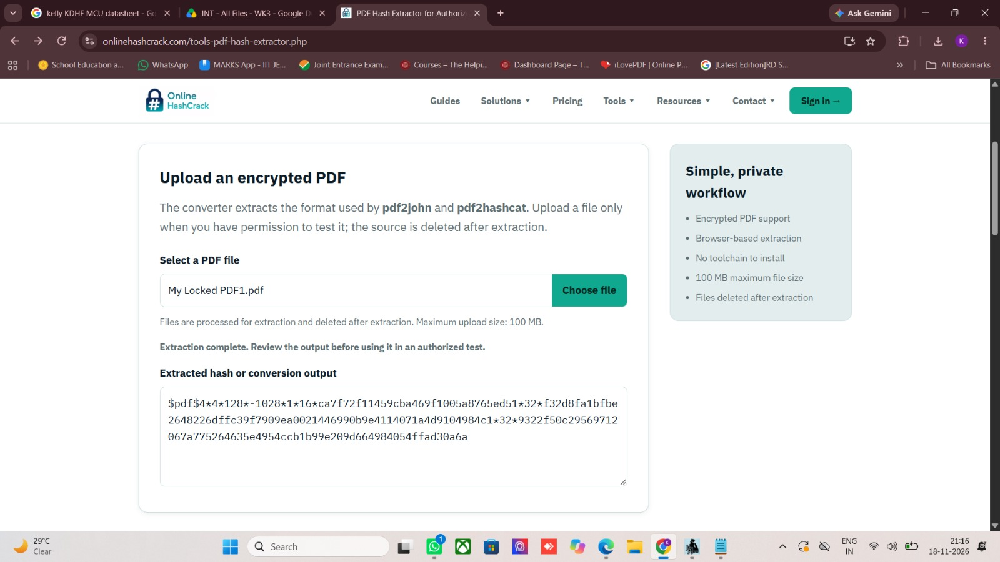
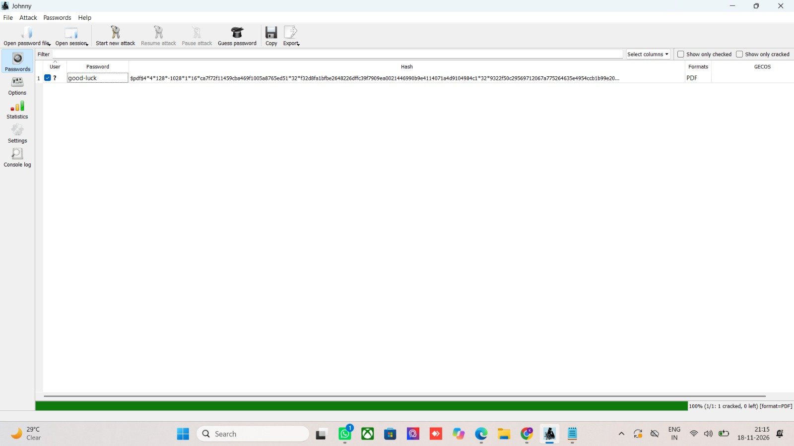
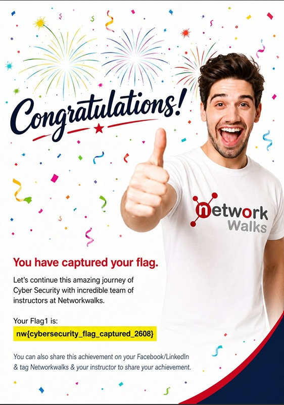
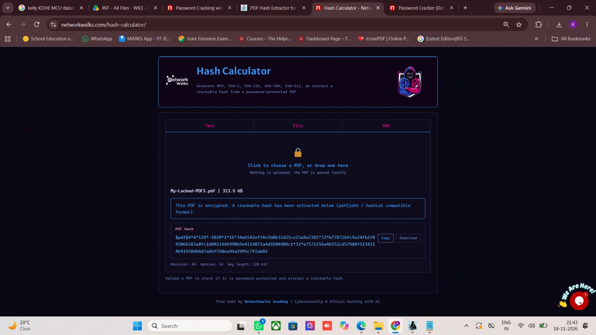
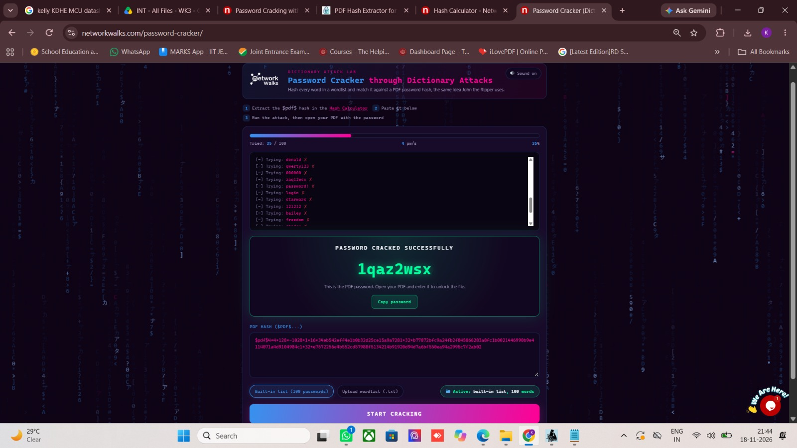
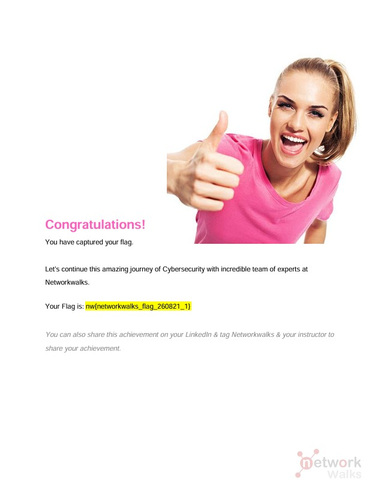

# NETWORKWALKS--KARTHIKEYA-B084-WK3-CYBERSECURITY-PASSWORD-CRACKING

**Internship:** Networkwalks Cybersecurity & Ethical Hacking Internship
**Intern Name / ID:** KARTHIKEYA B084
**Week:** Week 3
**Task:** Password Cracking (Project Module 1 & Project Module 2)

---

## Overview

This repository documents Week 3 of the Networkwalks Cybersecurity & Ethical Hacking internship. The goal of the week was to recover the password of an encrypted PDF file using two different approaches:

- **PM1 — Password Cracking with JTR (John the Ripper / Johnny):** cracking `My Locked PDF1.pdf` using the industry-standard JTR tool suite on Windows.
- **PM2 — Password Cracking with Networkwalks Tools:** cracking `My Locked PDF3.pdf` using Networkwalks' free browser-based Hash Calculator and Password Cracker tools.

Both tasks follow the same underlying concept: extract the password hash stored inside the encrypted PDF, then run a dictionary attack against that hash until a matching password is found.

---

## Objectives

- Understand how password-protected files store their password as a hash, and why that hash can be targeted for recovery.
- Learn the difference between **encryption** (two-way, reversible with a key) and **hashing** (one-way, used to validate a password guess).
- Practice extracting a crackable hash (`$pdf$...` format, compatible with `pdf2john` / `hashcat`) from an encrypted PDF.
- Use **John the Ripper (JTR)** and its GUI front-end **Johnny** to run a dictionary attack against the hash.
- Use the **Networkwalks Hash Calculator** and **Networkwalks Password Cracker** as a lightweight, no-install browser-based alternative to JTR.
- Successfully recover the PDF password and open the protected file in both tasks.

---

## Tools Used

| Tool | Purpose | Used In |
|---|---|---|
| John the Ripper (JTR) | Password/hash cracking engine | PM1 |
| Johnny | GUI front-end for JTR | PM1 |
| onlinehashcrack.com — PDF Hash Extractor | Extracts `$pdf$...` hash from a locked PDF (pdf2john equivalent) | PM1 |
| Networkwalks Hash Calculator (`networkwalks.com/hash-calculator`) | Extracts `$pdf$...` hash from a locked PDF, parsed locally in-browser | PM2 |
| Networkwalks Password Cracker (`networkwalks.com/password-cracker`) | Runs a dictionary attack against the extracted PDF hash | PM2 |
| Adobe Acrobat Reader DC | Opens the PDF with the recovered password to confirm success | PM1 & PM2 |
| Notepad | Used to save the extracted hash as a `.txt` file for Johnny | PM1 |

---

## Task 1 — PM1: Password Cracking with JTR

**File used:** `My Locked PDF1.pdf`

### Steps Performed

1. Uploaded `My Locked PDF1.pdf` to the **PDF Hash Extractor** tool (`onlinehashcrack.com/tools-pdf-hash-extractor.php`) to generate a crackable `$pdf$...` hash in `pdf2john` / `hashcat` compatible format.
2. Copied the extracted hash and saved it into a text file (`hash1.txt`) using Notepad.
3. Opened **Johnny** (the GUI front-end for JTR), pointed it to the installed `john.exe` executable, and loaded `hash1.txt` via **Open password file**.
4. Clicked **Start new attack** and let JTR run its dictionary/wordlist attack against the hash.
5. JTR successfully cracked the hash and returned the plaintext password: **`good-luck`**.
6. Opened `My Locked PDF1.pdf` in Adobe Acrobat Reader and entered the recovered password to unlock the file.
7. The unlocked PDF revealed the first flag.

### Result

- **Cracked Password:** `good-luck`
- **Flag Captured:** `nw{cybersecurity_flag_captured_2608}`

### Screenshots

**1. Hash extracted from `My Locked PDF1.pdf` via the PDF Hash Extractor**



**2. Johnny (JTR GUI) cracked the hash — password `good-luck`**



**3. Flag captured after unlocking the PDF**



---

## Task 2 — PM2: Password Cracking with Networkwalks Tools

**File used:** `My Locked PDF3.pdf`

### Steps Performed

1. Opened the **Networkwalks Hash Calculator** (`networkwalks.com/hash-calculator`) and uploaded `My-Locked-PDF3.pdf` under the **PDF** tab.
2. The tool parsed the file locally in the browser and extracted a crackable `$pdf$...` hash (Revision R4, Version V4, Key length 128-bit).
3. Copied the full hash value using the **Copy** button.
4. Opened the **Networkwalks Password Cracker** (`networkwalks.com/password-cracker`) and pasted the hash into the **PDF Hash** field.
5. Ran the attack using the built-in 100-word list by clicking **Start Cracking**. The tool tried each word in the list against the hash in real time.
6. The tool matched the password after trying several candidates and displayed: **Password Cracked Successfully → `1qaz2wsx`**.
7. Opened `My Locked PDF3.pdf` and entered `1qaz2wsx` to unlock it.
8. The unlocked PDF revealed the second flag.

### Result

- **Cracked Password:** `1qaz2wsx`
- **Flag Captured:** `nw{networkwalks_flag_260821_1}`

### Screenshots

**1. Hash extracted from `My-Locked-PDF3.pdf` via the Networkwalks Hash Calculator**



**2. Networkwalks Password Cracker — password cracked (`1qaz2wsx`)**



**3. Flag captured after unlocking the PDF**



---

## Summary of Results

| Module | File | Tool(s) Used | Cracked Password | Flag |
|---|---|---|---|---|
| PM1 | My Locked PDF1.pdf | JTR + Johnny + Online Hash Extractor | `good-luck` | `nw{cybersecurity_flag_captured_2608}` |
| PM2 | My Locked PDF3.pdf | Networkwalks Hash Calculator + Password Cracker | `1qaz2wsx` | `nw{networkwalks_flag_260821_1}` |

---

## Problems & Solutions

| Problem | Solution |
|---|---|
| Extracted hash sometimes contains stray characters (e.g. a leading `b'`) when copied from certain extractor tools. | Cleaned the hash before saving so it starts exactly with `$pdf$...`, matching the format JTR/Johnny expects. |
| Johnny could not run an attack until it knew where JTR was installed. | Pointed Johnny to the correct `john.exe` path (inside the `run` folder of the JTR download) via **Settings → Browse**. |
| Needed to confirm the full, uninterrupted hash was captured from the Networkwalks Hash Calculator before pasting it into the Password Cracker. | Used the tool's **Copy** button directly instead of manually selecting text, to avoid truncating the hash. |

---

## Key Learnings

- A password-protected PDF does not store the plaintext password — it stores a **hash** derived from it, which is what cracking tools actually attack.
- **Encryption** is reversible with the correct key, while **hashing** is one-way; password cracking works by hashing guesses and comparing them to the stored hash, not by "decrypting" it.
- JTR/Johnny is a powerful, flexible, install-based approach widely used by security professionals, while the Networkwalks Hash Calculator and Password Cracker provide a fast, no-install, browser-based alternative that is convenient for quick checks.
- Weak, common passwords (like short dictionary words or simple keyboard patterns such as `1qaz2wsx`) are cracked almost instantly by a dictionary attack, reinforcing why strong, unique passwords matter.
- Both approaches converge on the same workflow: **extract hash → run dictionary attack → recover plaintext password → unlock the file**.

---

## Repository Structure

```
NETWORKWALKS--KARTHIKEYA-B084-WK3-CYBERSECURITY-PASSWORD-CRACKING/
├── README.md
└── images/
    ├── 01-pm1-hash-extraction-pdf1.png
    ├── 02-pm1-johnny-cracked-pdf1.png
    ├── 03-pm1-flag-captured-pdf1.png
    ├── 04-pm2-hashcalculator-pdf3.png
    ├── 05-pm2-passwordcracker-pdf3.png
    └── 06-pm2-flag-captured-pdf3.png
```

---

## References

- John the Ripper: https://www.openwall.com/john/
- Johnny (JTR GUI): https://openwall.info/wiki/john/johnny
- Networkwalks Hash Calculator: https://networkwalks.com/hash-calculator/
- Networkwalks Password Cracker: https://networkwalks.com/password-cracker/
- Networkwalks Academy: https://networkwalks.com/

---

*© Networkwalks Academy — Cybersecurity & Ethical Hacking Internship Project*
